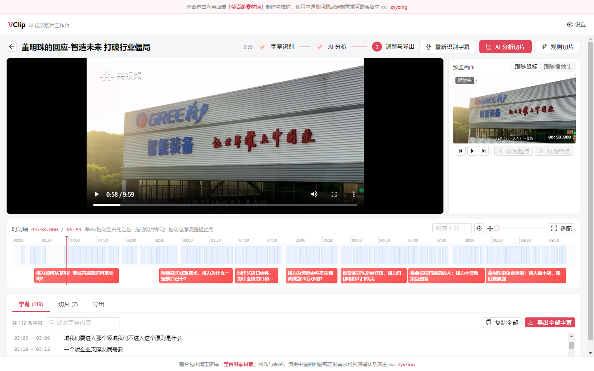
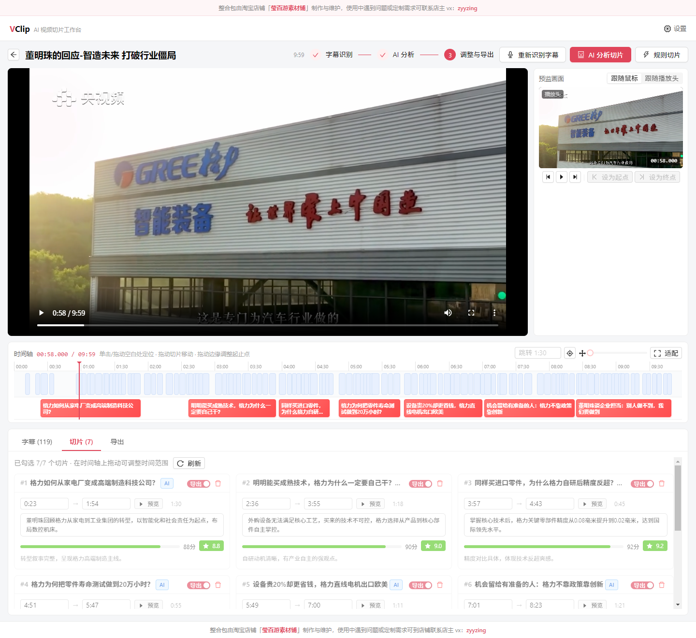

# VClip - AI 视频切片工作台

<p align="right">
  <a href="https://mp.weixin.qq.com/s/qblixxBs2pKeME8HrEfqFA"></a>
</p>

基于 **本地语音识别 + AI 大模型总结** 的智能视频切片桌面软件。

  

## ✨ 核心功能

1. **本地字幕识别**：内置 FunASR 系列本地模型（SenseVoice / Paraformer），离线运行、数据不出本机，首次在设置中一键下载模型
2. **AI 总结切片**：将带时间戳的字幕交给 AI 大模型（OpenAI 兼容接口：DeepSeek / 通义千问 / 硅基流动 / Ollama 等），自动生成切片建议（标题、摘要、起止时间、评分、推荐理由）
3. **可视化时间轴 + 精准定位**：
   - 字幕轨 + 切片轨双轨时间轴，切片支持**拖动移动、拖拽边缘调整起止点**、双击切换导出状态，所有调整实时保存
   - **单击/拖动空白处即可定位**，视频画面实时联动（`media://` 协议已实现 HTTP Range/206，任意位置可秒级 seek）
   - 工具栏可输入时间码跳转（`90` / `1:30` / `01:02:03`），支持键盘快捷键：空格播放暂停、`←/→` ±1 秒（`Shift` 为 ±5 秒）、`,`/`.` 逐帧
   - **鼠标悬停即显示该时刻画面缩略图** + 时间码 + 对应字幕文本，并画出与缩略图严格对齐的时标线
   - **预监画面面板**：与时间轴对齐的第二路画面，可切换「跟随鼠标位置 / 跟随播放头」，单击即跳转；选中切片后可一键把当前时间点「设为起点 / 设为终点」
4. **一键导出**：
   - FFmpeg 精确模式（重新编码，画面精准对齐）或快速模式（流复制，秒级完成）批量导出切片
   - **精确模式不生成任何字幕**（既不外挂 SRT 也不烧录进画面），避免重编码后时间基准偏移导致的字幕错位
   - 快速模式可选额外生成逐切片外挂 SRT
   - **导出内容可任选**：「单个切片」和「切片合集」两个勾选项互相独立 —— 只导切片、只导合集、或两者都要；都不勾时按钮置灰
   - **切片合集**：把所有选中切片按顺序首尾相接导出一个 `00_切片合集.mp4`（精确模式重编码拼接；快速模式优先流复制无损拼接，失败自动降级重编码）。**只导合集时**，各切片仅作为拼接中间产物切到临时子目录，拼完即整体清理，输出目录里只留一个合集文件
   - **全部字幕导出**：字幕页支持一键导出整份字幕为 SRT / 带时间码文本 / JSON（统一带 UTF-8 BOM，中文不会乱码），也可一键复制全部字幕；支持按内容搜索定位
5. **跨平台打包**：electron-builder 支持 Windows (NSIS 安装包) 与 macOS (DMG)

## 🖼️ 界面预览



*播放器 + 预监画面 + 双轨时间轴（字幕轨 / 切片轨）+ 底部「字幕 / 切片 / 导出」面板*


*鼠标滑过时间轴即显示该时刻的画面、时间码与字幕原文；右侧预监可切换"跟随鼠标 / 跟随播放头"*



*AI 切出的候选：标题、起止时间、摘要、推荐理由与评分，卡片开关控制是否参与导出*

## 📦 安装（从源码手动安装）

> ⚠️ **本仓库只发布源代码。** 仓库里**没有** Windows 安装包，**没有**免安装便携版（绿色包 `win-unpacked/`），
> 也**没有**语音识别模型权重（320MB+）—— 这些都是本机构建产物，已被 `.gitignore` 排除
> （`release/`、`models/`、`build/ffmpeg-bin/`）。
>
> 所以从这里拿到代码后，需要你**在自己的机器上手动安装依赖并构建**。
> 完整步骤（含每一步的踩坑说明）见 **[docs/INSTALL.md](docs/INSTALL.md)**。

| 项目 | 要求 |
| --- | --- |
| 操作系统 | Windows 10/11 x64（主力验证平台；macOS 可打 DMG） |
| Node.js | **≥ 18**，推荐 20 / 22 LTS |
| 磁盘 | ≥ 5GB（依赖 740MB + 模型 320MB + 构建产物约 1GB） |
| 额外依赖 | FFmpeg + ffprobe（构建时自动收集，或手动放入）、ASR 模型（应用内下载或手动放入） |

```powershell
git clone https://github.com/wyfirstname/videoclip.git
cd videoclip

# 国内先把镜像配好，否则 Electron 二进制（100MB+）大概率下载卡死
npm config set registry https://registry.npmmirror.com
$env:ELECTRON_MIRROR="https://npmmirror.com/mirrors/electron/"
$env:ELECTRON_BUILDER_BINARIES_MIRROR="https://npmmirror.com/mirrors/electron-builder-binaries/"

npm install
npm run dev        # 开发模式运行；首次进「设置 → 本地语音识别模型」下载模型
npm run dist:win   # 打包：release/<version>/VClip Setup <version>.exe + win-unpacked/（便携版）
```

- **模型怎么放**：应用内一键下载（推荐，落到 `%APPDATA%\vclip\models`），或手动解压到项目根 `models/<模型id>/`（`sense-voice-small`、`paraformer-zh-small` …，必需 `silero_vad.onnx`）—— 见 [docs/INSTALL.md 第 5 节](docs/INSTALL.md#5-准备语音识别模型)
- **FFmpeg 怎么来**：`build/ffmpeg-bin/ffmpeg.exe` + `ffprobe.exe` 放好即可（每个 > 64KB），或让 `beforePack.js` 从 `ffmpeg-static` / 系统 PATH 自动收集
- **打出来的包不要提交**：`release/` 整目录已在 `.gitignore` 中，安装包与绿色包只留在本机

> 打包时 `scripts/beforePack.js` 会自动把 ffmpeg / ffprobe（优先 `build/ffmpeg-bin` 缓存，其次 ffmpeg-static，最后系统 PATH）收集进安装包。

### 版本与发布

- 版本号唯一来源是 `package.json` 的 `version`，构建产物目录 `release/<version>/` 与之一致；git 侧用 `v<version>` 附件标签对应。
- 发布流程：改 `version` → `npm run dist:win` → `npm run verify:dist` → `git commit` → `git tag -a v<version>` → `git push --follow-tags`。
- 变更记录见 [CHANGELOG.md](CHANGELOG.md)。

## 📖 使用流程

1. **新建项目**：首页 → 新建项目 → 选择本地视频
2. **下载模型**：设置 → 本地语音识别模型 → 选择一个模型下载（推荐 SenseVoice Small，约 240MB；GitHub 慢可配置镜像前缀）
3. **识别字幕**：项目页 → 「识别字幕」，识别在独立进程运行，不影响界面
4. **切片**：三种方式任选
   - **AI 分析切片**：设置中配置 LLM API Key → 项目页 →「AI 分析切片」（智能选题、写标题摘要、打分）
   - **规则切片**：无需 API Key，按字幕语义边界自动聚合，适合快速出片或 AI 未产出时兜底
   - **手动切片**：直接在时间轴上拖拽调整，或编辑切片卡片的起止时间
5. **调整切片**：时间轴上拖动/缩放切片，或使用切片卡片的起止时间输入框；卡片开关可切换是否导出
6. **导出**：导出页选择模式与附件 → 一键导出（精确模式重新编码，快速模式流复制）；「单个切片」与「切片合集」可单独勾选或同时勾选，只勾合集时输出目录只留 `00_切片合集.mp4`
7. **导出全部字幕**：字幕标签页 → 「导出全部字幕」→ 选 SRT / 带时间码文本 / JSON；也可「复制全部」直接粘到别处

## 🧱 技术架构

```
├── electron/               # 主进程
│   └── src/
│       ├── main.ts         # 窗口、media:// 协议（含 Range/206）、IPC、全部字幕导出
│       ├── preload.ts      # contextBridge
│       ├── asr.ts          # ASR 编排（utilityProcess）
│       ├── asr-worker.ts   # 识别 worker（sherpa-onnx + VAD 分段）
│       ├── models.ts       # FunASR 系模型下载/管理
│       ├── ffmpeg.ts       # 音频提取 / 探测 / 切片
│       ├── llm.ts          # OpenAI 兼容客户端
│       ├── pipeline.ts     # 字幕分块 → AI 切片分析（含规则兜底）
│       ├── rules.ts        # 规则切片引擎（无需 LLM，语义边界聚合）
│       ├── prompts.ts      # 提示词（参考 autoclip 设计，时长自适应）
│       ├── export.ts       # 批量导出 + 切片合集 + 字幕序列化（SRT/TXT/JSON，UTF-8 BOM）
│       ├── concat.ts       # 切片合集拼接的纯逻辑（concat 清单转义 / 参数构造，可单测）
│       ├── utils.ts        # 时间码 / 字幕清洗去重 / 文件名净化
│       └── store.ts        # 项目/设置/字幕存储
├── src/                    # 渲染进程（React + Ant Design）
│   ├── components/Timeline.tsx     # 可视化时间轴（定位/擦洗/悬停缩略预览）
│   ├── components/ScrubVideo.tsx   # 单帧预览播放器（单飞 seek，用于缩略图与预监）
│   ├── components/SubtitlePanel.tsx# 字幕列表（搜索/复制/导出全部）
│   └── pages/                      # 首页 / 项目页 / 设置页
└── shared/types.ts         # 共享类型
```

- **本地 ASR**：[sherpa-onnx-node](https://github.com/k2-fsa/sherpa-onnx)（ONNX Runtime N-API 绑定），Silero VAD 语音分段 + token 级时间戳切句
- **媒体播放**：自定义 `media://` 特权协议。**必须自己实现 HTTP Range 206**：直接 `net.fetch(file://)` 会丢掉 Range 且不返回 `Content-Length`/`Accept-Ranges`，导致媒体元素 `seekable` 只有 `[0,0]`、只能缓冲开头几秒 —— 进度条拖不动、时间轴定位与预览全部失效
- **项目数据**：开发运行 `%APPDATA%/vclip`，安装后的包 `%APPDATA%/VClip`（macOS: `~/Library/Application Support/vclip`）。两个目录里都可能各有一份 `settings.json`（含 LLM API Key 明文），升级/卸载时不会被清理
- 参考：[autoclip_mvp](https://github.com/zhouxiaoka/autoclip_mvp) 的字幕分析流水线与提示词设计

## 🔒 敏感信息与打包脱敏

API Key 只在运行时写入用户数据目录（Windows `%APPDATA%\vclip\settings.json`，macOS `~/Library/Application Support/vclip/settings.json`），**不会进入安装包**。打包流程内置两道闸门，命中即中断打包：

| 闸门 | 位置 | 作用 |
| --- | --- | --- |
| 打包前 | `scripts/beforePack.js` → `scripts/scan-secrets.js` | 扫描即将入包的文件（`out/**`、`package.json`、`build/ffmpeg-bin`），命中 `sk-…`、`Bearer …`、Google/阿里云/腾讯云/GitHub/Slack 凭证、私钥块、字面量密钥赋值（`apiKey: 'xxx'`）即抛错退出 |
| 打包后 | `scripts/afterPack.js` | 对生成的 `app.asar` 再扫一遍，并检查包内是否混入 `settings.json` / `.env` / `*.pem` 等敏感文件 |

打包白名单为 `out/**`（仅编译产物），源码、脚本、文档、`.env`、`settings.json` 一律不进包；`.gitignore` 同样忽略这些文件。命中时只打印掩码片段（如 `sk-abc…456(len=35)`），不会把完整密钥写进日志。

```bash
npm run scan:secrets   # 全仓审计：源码/脚本/文档里有没有硬编码密钥
npm run verify:asar    # 校验已生成的 app.asar：目录结构 + 密钥扫描 + 代码标记
npm run scan:key       # 用「本机正在用的那把密钥原文」逐字节扫描（UTF-8/UTF-16LE/Base64 等 5 种变体）
npm run verify:dist    # 发布验收：从安装包内层解出 app.asar，字面量查密钥 + 结构 + 代码标记
                       # 若 7za 被本机安全策略拦截（spawn EBUSY），会自动降级验证同级
                       # win-unpacked/resources/app.asar，并额外对安装包本体做明文扫描
```

运行时脱敏：LLM 接口报错时，响应体里的密钥痕迹会先被抹成 `***REDACTED***` 再显示到界面（`llm.ts: redactSecrets`）。

### 安装包里为什么"看得到"我的 API Key？

不是被打包带进去了 —— 你看到的 Key 来自**本机运行时数据文件**，与安装包无关：

```
应用启动 → 读 %APPDATA%\VClip\settings.json（没有就用代码里的空默认值）
设置页保存 → 写同一个文件
```

所以「新装的包打开后设置页里还有 Key」，只是因为**这台机器上早先就存过这个文件**。验证方法（三步，可自行复现）：

1. `npm run verify:dist` —— 从安装包内层解出 `app.asar`，用本机真实密钥的 5 种编码变体做字面量扫描，应为 **0 命中**；同时确认包内没有 `settings.json` / `.env` / `*.pem`（0.2.2 包：11330 个条目全部通过）。
   - 本机安全策略会拦截 **node 侧** 对 `7za.exe` 的 spawn（`EBUSY`，但 bash 通道正常）。此时脚本会打印醒目提示并降级验证 `release/<ver>/win-unpacked/resources/app.asar`，同时补做安装包本体的明文扫描。要 100% 确认内外层等价，用 bash 手工解包比对 SHA256（见下文第 11 条）。
2. `test/e2e/probe-nokey.js`（A 组）—— 用**安装包内的主进程** + 干净用户目录启动，`settings:get` 返回的 `apiKey` 为空、走代码默认值，且应用**不会**自己写出 `settings.json`。
3. 同脚本（B 组）—— 预先放一份 `settings.json`，应用读到的就是该文件里的值。故密钥来源只能是本机文件。

另外：只要在设置页改了 Key，旧的那份明文就留在 `%APPDATA%\vclip\settings.json` 里（未加密）。共用机器或做磁盘镜像前，建议删掉该文件。

## 📄 License

[MIT](LICENSE) © 2026 wyfirstname

## 📚 更多文档

| 文档 | 内容 |
| --- | --- |
| [docs/INSTALL.md](docs/INSTALL.md) | **从源码手动安装的全流程**：环境要求、依赖镜像、FFmpeg、模型放置、打包、数据目录、排错 |
| [docs/QUICKSTART.md](docs/QUICKSTART.md) | 快速上手三步走 + Windows 打包踩坑记录（winCodeSign / 缓存根目录） |
| [docs/BLOG.md](docs/BLOG.md) | 项目介绍博文：技术选型、六个关键实现细节、踩坑清单（含 7 张真实运行截图） |
| [docs/BLOG.standalone.md](docs/BLOG.standalone.md) | 同一篇博文的**自包含版**：截图以 base64 内嵌，单文件即可完整显示，适合粘到不支持本地上传图片的编辑器 |
| [CHANGELOG.md](CHANGELOG.md) | 版本变更记录 |

## ❓ 常见问题（实测记录）

**1. `npm install` 卡在 Electron 二进制下载**
Electron 的 postinstall 会从 GitHub 拉取 100MB+ 的二进制，国内经常卡死。做法：先下 `npm install --ignore-scripts` 装好 JS 依赖，再单独下载对应版本的 zip（npmmirror 镜像 `https://registry.npmmirror.com/-/binary/electron/v<版本>/electron-v<版本>-win32-x64.zip`），解压到 `node_modules/electron/dist` 并写入 `node_modules/electron/path.txt`（内容 `electron.exe`）。

**2. Windows 打包报 `Cannot create symbolic link : 客户端没有所需的特权`**
electron-builder 首次打包解压 `winCodeSign`（含 macOS dylib 符号链接）时失败。解决方案见 [docs/QUICKSTART.md](docs/QUICKSTART.md#打包说明windows)，核心是预置 `%USERPROFILE%\.cache\electron-builder\winCodeSign\winCodeSign-2.6.0` 目录，或开启 Windows 开发者模式。

**3. 字幕时间不准 / 全是 0 秒**
Paraformer 系列模型不返回 token 级时间戳。应用已内置兜底逻辑（按字符比例分配 + VAD 分段 + 碎片合并），但要获得最精准的逐句时间，建议使用 **SenseVoice Small** 模型（支持 token 时间戳）。务必同时保留 `silero_vad.onnx`，VAD 分段对时间准确度影响很大。

**4. 识别很慢 / 界面卡住**
识别在 Electron `utilityProcess` 独立进程中运行，界面不会卡。速度取决于 CPU 与线程数（设置页可调）。1 小时视频用 Paraformer-small 在 8 核 CPU 上约 5-10 分钟。

**5. 没有 API Key 能用吗**
字幕识别和切片导出完全本地；仅「AI 分析切片」需要 LLM。可用本地 Ollama：Base URL 填 `http://localhost:11434/v1`，模型填 `qwen2.5:7b` 之类。

**6. 提示「模型尚未下载」**
设置页指定的模型未下载时会自动回退到任一已下载模型；若一个都没有，请到「设置 → 本地语音识别模型」下载（推荐 SenseVoice Small，含精确时间戳）。

**7. 识别报 `spawn UNKNOWN` / 找不到 FFmpeg**
随包 ffmpeg 缺失或损坏。重新打包即可（`scripts/beforePack.js` 已加二进制体积校验，找不到真实 ffmpeg 会直接构建失败）；也可在「设置 → FFmpeg 路径」手动指定本机 ffmpeg。

**8. AI 分析完成却没有切片**
已从三处根治，若仍遇到请按顺序排查：
- **旧版本缺陷**：切片时长下限曾硬编码为 15 秒，短视频（<15s）的候选会被全部丢弃 —— 现已改为随素材总长自适应（短视频可低至 3 秒）。
- **模型过于挑剔**：提示词原先要求「45 秒以上、宁缺毋滥」，模型对内容平淡的素材会直接返回空数组 —— 现在提示词明确**禁止返回空数组**，并要求短视频整段成片。
- **兜底保障**：若 AI 仍无产出（返回空/解析失败），会自动改用**规则切片**产出候选，保证「有字幕就有切片」。也可直接点项目页的「规则切片」按钮，不需要 API Key。

**9. 导出后没有任何文件**
先在「导出」页确认至少勾选了 1 个切片（切片卡片右上角开关为「导出」状态）。导出前会自动保存当前编辑，输出目录为「设置 → 输出目录」，留空则用系统「视频」目录下的 `VClip/<项目名>`。

**10. 时间轴点了没反应 / 进度条拖不动 / 预览画面不动**
这是 v0.1.x 的真实缺陷，v0.2.0 已修：`media://` 协议早期直接返回 `net.fetch(file://)`，响应里既没有
`Content-Length` 也没有 `Accept-Ranges`，请求的 `Range` 头还被丢掉 —— 媒体元素的 `seekable` 只有
`[0,0]`，**任何 seek 都无效**（只能播开头缓冲的那几秒）。现在协议自己实现了 200/206 + `Content-Range`。
自检方法：控制台执行 `fetch('media://file/D%3A/a.mp4',{headers:{Range:'bytes=0-99'}})`，
应返回 `206` + `bytes 0-99/<size>`；`document.querySelector('video').seekable.end(0)` 应等于完整时长。

**11. 精确模式导出的字幕为什么不见了 / 外挂字幕对不上**
**这是刻意行为**。精确模式会重新编码，输出的时间基准与原字幕不完全一致，外挂 SRT 会出现整体偏移、
和画面错位（也就是「字幕混乱」）。所以精确模式**一律不生成任何字幕文件，也不烧录进画面**，
导出结果里会用蓝色标签明确告诉你。需要字幕请用：
- 整份字幕 → 字幕标签页「导出全部字幕」（SRT / 带时间码文本 / JSON，带 UTF-8 BOM，中文不乱码）；
- 逐切片字幕 → 把导出模式切到「快速模式（流复制）」，再选「额外生成外挂 SRT」，此时时间戳与原片一致，不会错位。

**12. 字幕导出的文件在播放器里能显示中文吗**
能。SRT / TXT 都写入 UTF-8 BOM，Windows 记事本、PotPlayer、VLC 等都能正确识别；JSON 按规范不带 BOM。

**13. 打包在 `beforePack` 阶段报「未找到可用的 ffmpeg 二进制」**
`ffmpeg-static` 的 postinstall 产物（`node_modules/ffmpeg-static/ffmpeg.exe`）可能已被清理，而本机 PATH 探测又拿不到（node 侧调 `where` 在某些环境直接 `EBUSY`）。v0.3.1 起 `beforePack.js` 改为**缓存优先**：`build/ffmpeg-bin/` 里已有的 ffmpeg / ffprobe 直接复用，不再每次重新收集，也不再依赖网络或外部安装。若缓存也为空，手工放一份完整二进制（>64KB）进去即可：

```
build/ffmpeg-bin/ffmpeg.exe
build/ffmpeg-bin/ffprobe.exe
```

**14. `npm run verify:dist` 报「安装包内层解包失败：7za.exe: EBUSY」**
本机安全策略会拦截 **node 侧** 对 `7za.exe` 的 spawn（同一文件在 bash 通道能正常执行，重试无效）。脚本此时会自动降级验证 `win-unpacked/resources/app.asar` 并补做安装包本体明文扫描；要 100% 确认内外层字节一致，按上文「自测第 11b 条」用 bash 手工解包比对 SHA256。

**15. 切片合集的顺序 / 时长**
顺序就是切片列表顺序（失败的切片会被跳过，不会占位）。合集由**已成功切出的片段**拼接而成，因此合集时长恒等于各成功切片的时长之和。快速模式用 ffmpeg concat demuxer 做流复制拼接（秒级、无损）；万一片段参数不一致导致流复制失败，会自动降级为重新编码拼接，不会因为合集失败而丢掉单个切片（失败只在结果区以蓝色标签提示）。

> 「单个切片」与「切片合集」是两个独立勾选项，可单勾也可双勾。**只勾合集**时切片只是拼接中间产物：切到 `outputDir/.collection-parts/`，拼接完成后整体删除，输出目录里只留 `00_切片合集.mp4`；此时 `clips.json` 的 `file` 字段为 `null`（切片文件未保留）。两项都不勾会被拒绝并提示「请至少选择一种导出内容」。

---

## 🧪 自测 / 回归测试

`test/e2e/` 下是一套无需人工点击的端到端脚本，覆盖「上传视频 → 识别字幕 → 编辑切片 → 导出」全链路：

```bash
# 1) 上传 + 识别字幕（真实构建产物 out/main/index.js + 真实模型）
./node_modules/electron/dist/electron.exe test/e2e/flow.js --disable-gpu --no-sandbox

# 2) 切片全链路：AI 分析 → 规则切片 → 精确/快速两种模式导出（含 LLM 原始响应）
./node_modules/electron/dist/electron.exe test/e2e/slice.js --disable-gpu --no-sandbox

# 3) 真实长视频全链路：新建项目 → 识别字幕 → AI 分析 → 导出
VCLIP_VIDEO="E:\path\video.mp4" ./node_modules/electron/dist/electron.exe test/e2e/fullflow.js --disable-gpu --no-sandbox

# 4) 设置页 / 切片保存 / 导出 / AI 分析报错路径
./node_modules/electron/dist/electron.exe test/e2e/stages.js --disable-gpu --no-sandbox

# 5) media:// 协议方案对照（验证视频可播放的关键回归测试）
./node_modules/electron/dist/electron.exe test/e2e/proto3.js --disable-gpu --no-sandbox

# 6) 本轮新功能：时间轴定位/悬停缩略预览/预监 + 全部字幕导出 + 精确模式无字幕（44 项断言）
./node_modules/electron/dist/electron.exe test/e2e/features.js

# 7) media:// Range / seek 能力探针（视频能播但拖不动的排查利器）
./node_modules/electron/dist/electron.exe test/e2e/probe-media.js

# 8) 直接对「打包产物」跑端到端（require release/<ver>/win-unpacked/resources/app.asar 里的主进程）
./node_modules/electron/dist/electron.exe test/e2e/probe-packaged.js

# 9) 校验已打包的 app.asar：不含敏感文件/密钥，且代码为最新构建
#    不带参数时自动选取最新 release 产物；也可显式指定路径
node test/e2e/verify-asar.js
# node test/e2e/verify-asar.js "release/0.3.3/win-unpacked/resources/app.asar"

# 10) 脱敏闸门自检：往 out/ 塞一个假 key，打包必须中断（预期 exit≠0）
#     （假 key 用拼接生成，避免文档本身被扫描器命中）
node -e "require('fs').writeFileSync('out/leak-test.js','const API_KEY = \"sk-'+'x'.repeat(32)+'\"')"
npx electron-builder --win --dir; rm -f out/leak-test.js

# 11) 发布验收：安装包内层 app.asar 不含本机真实密钥（字面量比对，最严格）
npm run verify:dist

# 11b) 若上面提示「内层解包失败」（node 侧 spawn 7za 报 EBUSY，bash 通道正常）：
cp node_modules/7zip-bin/win/x64/7za.exe /tmp/7za-copy.exe    # 原文件本身也会 EBUSY，副本可用
/tmp/7za-copy.exe x "release/<ver>/VClip Setup <ver>.exe" "resources\\app.asar" -o/tmp/inner -y
sha256sum /tmp/inner/resources/app.asar "release/<ver>/win-unpacked/resources/app.asar"   # 必须一致

# 12) A/B 实验：安装包内的主进程 + 干净用户目录 → API Key 必须为空
MODE=clean ./node_modules/electron/dist/electron.exe test/e2e/probe-nokey.js --disable-gpu --no-sandbox
MODE=seed  ./node_modules/electron/dist/electron.exe test/e2e/probe-nokey.js --disable-gpu --no-sandbox

# 13) 用本机真实密钥原文扫指定目录（默认扫全项目 + 用户数据目录）
npm run scan:key
```

脚本默认用 `test/e2e/userdata`（或 `userdata-full`）作为隔离的用户数据目录，测试视频可用环境变量指定：`VCLIP_VIDEO="D:\path\a.mp4"`。

> **前置条件会自动处理**：脚本通过 `test/e2e/_prereq.js` 在启动前把 `build/ffmpeg-bin` 的 ffmpeg 路径写进隔离 userData 的
> `settings.json`，并把项目 `models/` 目录联接到该 userData 下。
> 原因是**直接用 electron 跑 e2e 时 `app.getAppPath()` 并不是项目根**，应用自带的 `build/ffmpeg-bin` 与 `models/`
> 两条探测路径都会落空 —— 结果就是导出报「未找到可用的 FFmpeg」、`project:create` 探到的时长为 0
> （进而时间轴定位/联动也一并失败）、ASR 脚本报「模型未下载」。无需再手工建软链。
>
> 未改动应用侧代码：走的是「设置里指定 ffmpeg 路径」这一既有分支，所以打包产物与源码仍然一致。

> 运行时若报 `app.setPath` 未定义 / `bad option: --disable-gpu`，说明被 `ELECTRON_RUN_AS_NODE=1`
> 带成了纯 Node 模式，用 `env -u ELECTRON_RUN_AS_NODE ./node_modules/electron/dist/electron.exe <脚本>` 再跑。

> `test/e2e/proto-page3.html` 由 `proto3.js` 运行时自动生成，不是需要维护的源文件。

已验证结论（回归基线）：

| 检查项 | 期望 |
| --- | --- |
| `<video>` 播放状态 | `readyState=4`，`error=null` |
| `media://` Range | `fetch(url,{headers:{Range:'bytes=0-99'}})` → `206` + `Content-Range: bytes 0-99/<size>`；`video.seekable.end(0)` = 完整时长 |
| 时间轴定位 | 单击/拖动空白处后播放头移动、`video.currentTime` 跟随到对应秒数 |
| 悬停预览 | 出现缩略图且已解码（`videoWidth > 0`）+ 时间码 + 时标线；鼠标离开后消失 |
| 预监画面 | 与时间轴同一时刻（`monitor.currentTime` 与悬停时间码一致），可切「跟随鼠标/跟随播放头」 |
| 全部字幕导出 | SRT/TXT/JSON 三格式均可导出，SRT/TXT 带 UTF-8 BOM、去重、时间单调无重叠 |
| 精确模式导出 | 产出 `.mp4`，**目录内不存在任何切片同名 `.srt`**，`notes` 含「不生成任何字幕文件」 |
| 导出内容可任选 | 四种组合都成立：仅切片（无合集）/ 仅合集（目录内**无任何独立切片**、`.collection-parts` 已清理、`clips.json` 的 `file` 为 `null`）/ 两者都要（切片 + `.srt` + `00_切片合集.mp4` + `clips.json`）/ 都不勾（报「请至少选择一种导出内容」）。合集时长 ≡ 各独立切片时长之和（差 < 0.35s） |
| 快速模式 + sidecar | 生成外挂 `.srt`，无负时间码 |
| 识别结果 | 返回字幕条数 > 0，进度事件含 `VAD` 阶段（无「VAD 不可用」） |
| AI 分析（有内容的视频） | 切片数 > 0，且 `usedRuleFallback=false` |
| AI 分析（短视频/贫乏内容） | 切片数 ≥ 1（禁止空数组 + 规则兜底），`source` 为 `ai` 或 `rule` |
| 未配置 LLM | 报「请先在设置中配置 AI (LLM) API Key」，而非崩溃 |
| 制作方信息栏 | 所有页面**顶部与底部**固定显示制作方信息（不随内容滚动）；包内 asar 含「莹百游素材铺」「zyyzing」标记 |


